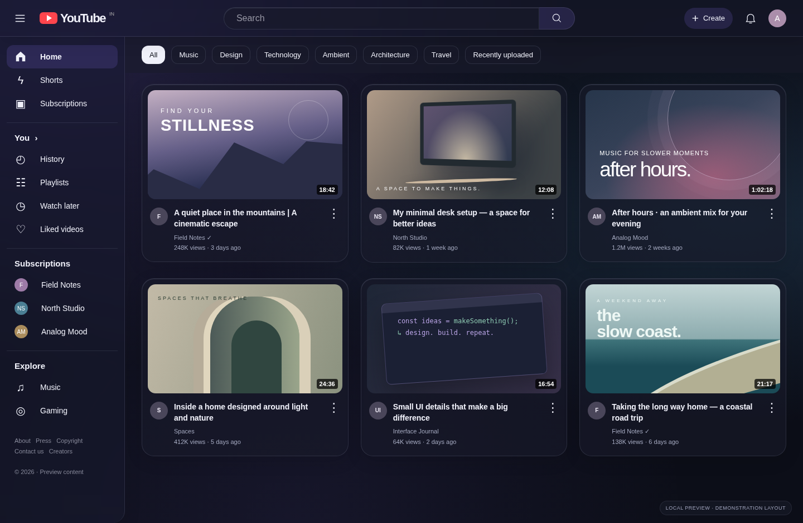

# YouTube Glass

A Chrome extension that gives desktop YouTube a glassmorphism finish: translucent navigation, frosted menus, soft ambient colors, and rounded video cards.

[Download the extension ZIP](youtube-glass.zip?raw=1)



The image above uses a local demonstration layout. Live YouTube compatibility remains unverified.

## Install in Chrome

1. Download and unzip `youtube-glass.zip` into a folder you plan to keep.
2. Open **chrome://extensions** in Google Chrome.
3. Turn on **Developer mode** in the top-right corner.
4. Click **Load unpacked** and select the unzipped `youtube-glass` folder containing `manifest.json`.
5. Open or refresh **https://www.youtube.com/**.
6. Click Chrome’s puzzle-piece icon and pin **YouTube Glass**. Click its icon to customize the theme.

No build, account, API key, or subscription is needed. This is an unpacked extension; it has not been published to the Chrome Web Store.

## Customize

- **Glass effect:** switch the theme on or off instantly on open YouTube tabs.
- **Accent color:** choose violet, blue, rose, or mint.
- **Glass intensity:** adjust background color strength and panel blur. At zero, the rounded translucent theme remains; switch Glass effect off to restore YouTube completely.
- **Reduce motion:** remove theme transitions. Your operating system’s reduced-motion preference is also respected.

Settings save on this device. The theme follows YouTube’s own light or dark appearance. To change it, use YouTube’s profile menu → Appearance.

## Privacy and compatibility

The extension runs only on `https://www.youtube.com/*` and requests only the `storage` permission. It does not send data, load remote scripts/fonts, inspect your watch history, or change video playback. There is no background worker, analytics, or backend.

YouTube changes its markup regularly, so some new or experimental layouts may need selector updates. Embedded videos, YouTube Music, YouTube Studio, and the mobile site are outside this extension’s scope. If a panel looks unusual, turn off the effect from the popup. If you disable or remove the extension in `chrome://extensions`, refresh open YouTube tabs to clear its injected styles.

## Development

The extension uses plain HTML, CSS, and JavaScript and Chrome Manifest V3. There are no runtime dependencies.

```sh
npm test
```

The dependency-free tests need Node.js 18+ and cover settings normalization, live changes, restoration when disabled, initialization races, manifest assets and permissions, and CSS isolation. Browser checks can be run with Playwright and Chromium using `node tests/browser-check.cjs`. They use routed local fixtures and a simulated Chrome storage bridge to exercise the popup and theme without making requests to YouTube. Set `CHROMIUM_PATH` if Chromium is installed somewhere other than `/usr/bin/chromium`.

The supplied version passed these unit and browser fixture checks. The build workspace’s managed browser blocks installation of unpacked extensions, so actual extension loading and compatibility with live YouTube have not been verified here. To check those, follow the installation steps in your own Chrome and try the home feed, search, a watch page, and switching between light and dark appearances.

- `manifest.json`: Chrome configuration and site scope.
- `content.js`: reads settings and updates namespaced root attributes.
- `theme.css`: styles scoped to the extension’s enabled attribute.
- `popup/`: settings interface and local storage.
- `icons/`: bundled extension icons.

After editing extension code, click **Reload** on its card in `chrome://extensions`, then refresh YouTube. Setting changes from the popup apply immediately.

YouTube Glass is an independent project and is not affiliated with Google or YouTube.
