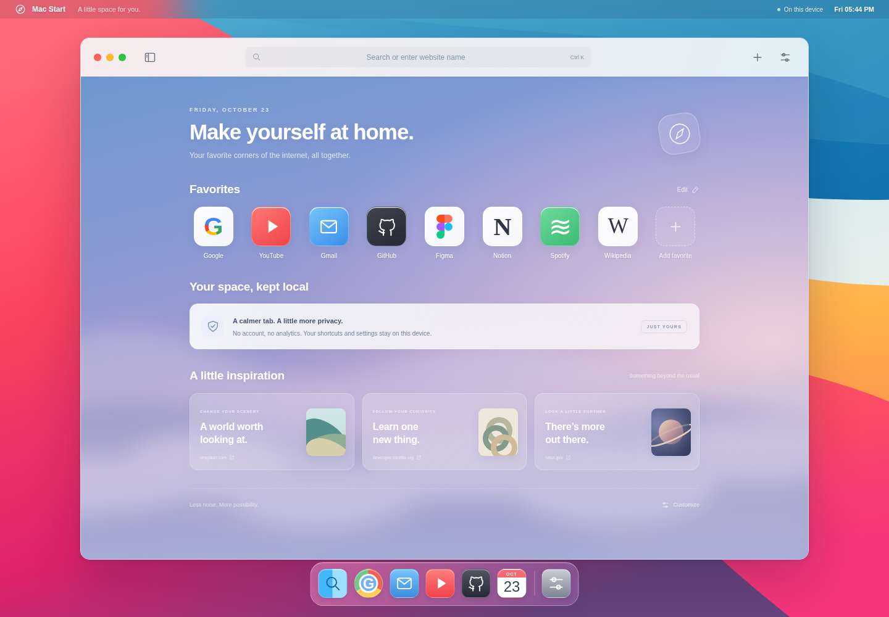

# Mac Start

A Safari-inspired Chrome New Tab extension based on the look of macOS Big Sur. Includes an original desktop wallpaper, a frosted window frame, three bundled start-page backgrounds, editable favorites, a quick-launch dock, and local customization.

[Download Mac Start ZIP](../mac-start.zip?raw=1)



## Download and install

1. Extract `mac-start.zip` into a folder named `mac-start`.
2. Open **chrome://extensions** in Chrome and enable **Developer mode**.
3. Click **Load unpacked** and choose the folder that directly contains **manifest.json**.
4. Open a new tab. If Chrome asks whether to keep the new start page, choose **Keep it**.
5. Optionally pin **Mac Start** from Chrome’s puzzle-piece menu. Its toolbar icon also opens the page.

The ZIP places `manifest.json` at the archive root to avoid a second nested extension folder. Keep the extracted folder on your device while the extension is installed. No build, account, or API key is required.

## What it changes

Mac Start replaces Chrome’s **New Tab page**. The toolbar, traffic lights, desktop backdrop, and dock inside the page are visual elements of the start page. The traffic lights are decorative.

Chrome extensions cannot relocate Chrome’s real window controls, replace the native tab strip or address bar with Safari’s, or turn Windows/ChromeOS into macOS. Open websites keep their own appearance. For a more immersive view, use your browser or operating system’s normal full-screen control; the extension does not enter full screen automatically.

Mac Start can run alongside YouTube Glass. Disable any other New Tab replacement extension if Chrome selects that one instead.

## Features

- Search or enter a web address in the window’s search bar. **Ctrl+K** or **Command+K** focuses it.
- Choose Google, DuckDuckGo, or Bing as your search engine.
- Add up to 24 favorites. Click **Edit**, then a favorite to rename it, change its address/color, or remove it.
- Open the sidebar for a compact list of favorites.
- Use the dock to open Search, Google, Gmail, YouTube, GitHub, Calendar, or customization.
- Open **Customize** to show/hide page sections, use a first-name greeting, choose a background, or upload a JPG, PNG, or WebP up to 3 MB.
- Use **Reset appearance** to restore the original visual settings. Your favorites, name, and search-engine choice are retained.
- The clock and greeting follow your device’s local time. Reduced motion and increased contrast preferences are respected.

## Privacy

The only requested permission is **storage**. Shortcuts and settings are saved locally on this device using `chrome.storage.local`; they are not synced by this extension. Uploaded backgrounds are also saved locally. There are no remote fonts, remote wallpaper requests, analytics, history/bookmark permissions, or trackers. Clicking a website or submitting a search opens the chosen external service as usual.

The privacy note describes this extension’s local behavior. This extension does **not** block trackers or provide a Safari privacy report.

## Development and verification

Uses plain HTML, CSS, JavaScript, SVG assets, and Manifest V3. There are no runtime dependencies.

```sh
npm test
```

Tests require Node.js 18+. Optional browser tests need Playwright and Chromium:

```sh
npm run test:browser
```

Set `CHROMIUM_PATH` to your Chromium executable if it is not `/usr/bin/chromium`. Browser checks serve the real extension UI through intercepted local HTTPS responses, enforce the script CSP, and simulate Chrome storage. They cover favorites, saved customization, search, uploaded backgrounds, keyboard interaction, and mobile layout. The managed build browser blocks installing unpacked extensions, so actual Chrome installation must be checked in your own browser using the steps above.

This independent project is not affiliated with Apple, Google, or the linked websites. Bundled wallpapers and icons were created for this extension; no macOS system files are included.
